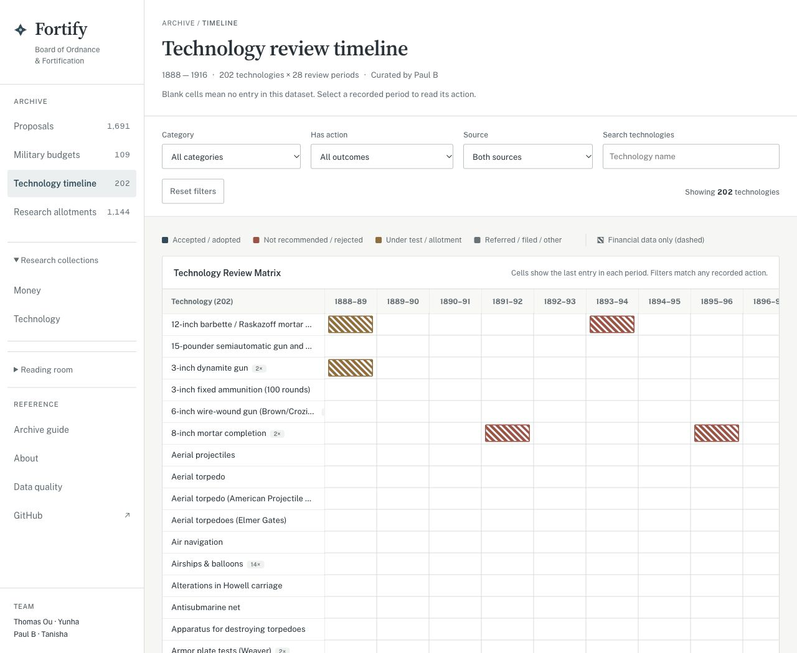

# Fortify | Board of Ordnance & Fortification Archive

**Live demo: [smokeybear10.github.io/104.RSCH.fortify](https://smokeybear10.github.io/104.RSCH.fortify/)**

This archive brings together selected proposal transcriptions, military appropriations, research allotments, and technology reviews from the U.S. Board of Ordnance and Fortification.

## Start Here

Open the [archive](https://smokeybear10.github.io/104.RSCH.fortify/) to search a proposal and read its recorded action. The [archive guide](explainer.html) explains the source sets, date coverage, and classification rules. Both use saved data and can be read without running the Python pipeline.

The research question is how proposed technologies moved through review and funding. The archive supports comparisons within the transcribed records; it does not establish the Board’s overall approval rate or the effectiveness of its spending.


## Run the Archive

The dashboard uses the data already in this repository. No account, private data access, or Python packages are needed to view it.

```bash
git clone https://github.com/Smokeybear10/104.RSCH.fortify.git
cd 104.RSCH.fortify
python3 -m http.server 2104 --bind 127.0.0.1
```

Open http://localhost:2104

## Explore the Records

- Search and filter proposals, read recorded actions, and export matching records.
- Compare Army and Navy appropriations in nominal or source-provided 2025 dollars.
- Follow technologies across reporting periods and inspect each recorded action.
- Review Board appropriations and individual allotments, including revocations.



## Data and Methods

| Dataset | Coverage |
| --- | --- |
| Proposals | 1,691 records; 1,558 dated 1897–1907 and 133 without a year |
| Military appropriations | 109 Army/Navy entries, 1866–1920; Army 1879 is missing |
| Board appropriations | 33 annual entries, 1888–1920 |
| Research allotments | 1,144 entries, 1888–1918 |
| Technology timeline | 202 technologies across 28 reporting periods, 1888–1916 |

This is a collection of selected transcriptions, not a complete inventory of the Board’s work. Proposal categories are assigned by keyword rules; the recorded action remains the evidence. Negative phrases such as “not approved” take precedence over positive keywords. Missing or unmatched actions are left unclassified. Proposer types are also inferred and should not be treated as verified affiliations.

Allotments are allocations, not confirmed expenditure or investment returns. Year and allotment date are shown as transcribed and may differ; dates have not been reconciled against the original reports. The budget worksheet supplies the 2025-dollar values; the adjustment method is not documented here. See the [archive guide](explainer.html) for definitions, coverage, and source files.

## Project Structure

```text
index.html, app.js, style.css  # Archive interface
explainer.html                # Coverage and methods
bof_pipeline/                 # Transformation and chart generation
output/                       # Public CSV exports and research charts
timeline-data.js               # Curated technology review records
team/                         # Researcher contributions
```

## Reproduce the Proposal Processing

Rebuilding requires access to the private research workbooks. It is separate from running the dashboard.

```bash
python3 -m venv .venv
source .venv/bin/activate
pip install -r requirements.txt
./bootstrap-data.sh
python run_bof_analysis.py \
  --input-dir "Data/Subjects Considered Data Visualization Assignment" \
  --output-dir work/proposals
```

The bootstrap script requires authenticated GitHub CLI access to the private data repository. Compare the regenerated `work/proposals/all_structured_records.csv` with the [saved proposal export](output/all_structured_records.csv). This command leaves the saved export unchanged. Other `run_*.py` entry points rebuild the budget, allotment, and researcher charts; they use different inputs.

Full reproduction is limited by access to the private workbooks. The public CSVs and charts support inspection of the derived results, but do not independently verify transcription against the original reports.

## Team

- **Thomas Ou:** data pipeline, dashboard, master ledger, and historical events timeline.
- **Yunha:** allotment analysis by technology, annual funding patterns, and proposal comparisons; [source research site](https://paull0318.github.io/BOF-Visuals-20260511/).
- **Paul B:** technology review records and classification.
- **Tanisha:** technology prevalence analysis; [original R script](team/tanisha/technology_prevalence.R).
