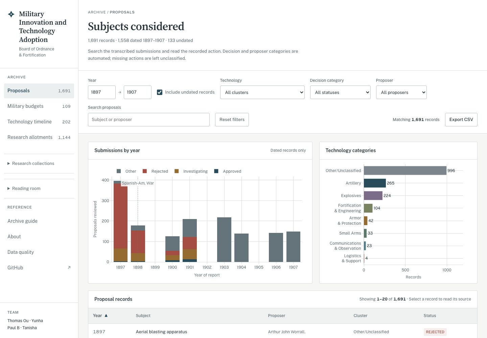
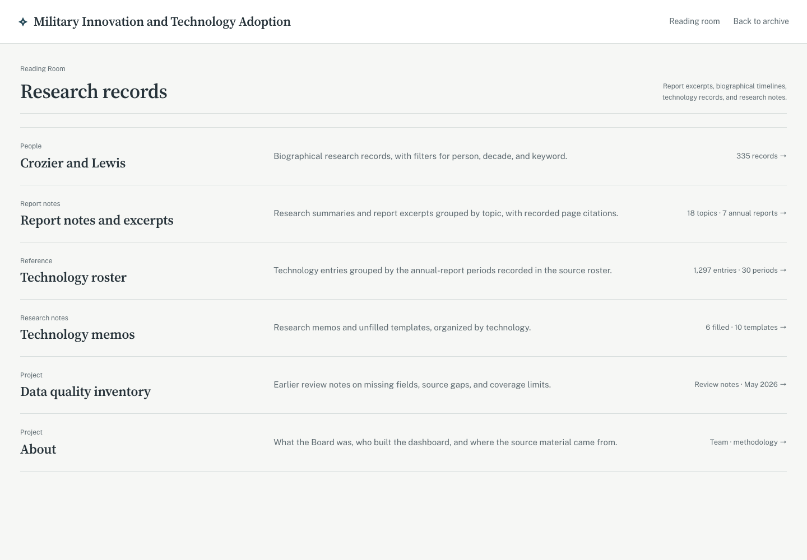

# Military Innovation and Technology Adoption

**Live archive: [Browse the records](https://smokeybear10.github.io/105.RSCH.military-innovation-and-technology-adoption/)**

Research on how new technologies are evaluated, funded, and adopted in national security.

The current study examines the U.S. Board of Ordnance and Fortification: which proposals received support, how funds were allocated, and how recorded decisions changed over time. The repository contains a searchable archive, public data exports, and the code used to process the records.



## Quick Start

The archive runs from the included files. Python 3 is enough to serve it locally; no account or package installation is needed.

```bash
git clone https://github.com/Smokeybear10/military-innovation-and-technology-adoption.git
cd military-innovation-and-technology-adoption
python3 -m http.server 2104 --bind 127.0.0.1
```

Open http://localhost:2104

## What It Does

Search proposals by subject, proposer, year, and recorded decision; inspect the transcribed action; and export matching records. The technology timeline groups review and financial entries by technology and reporting period.

Budget views compare Army and Navy appropriations in nominal or source-provided 2025 dollars. Board appropriations and individual research allotments are shown separately, including revocations.



## Data and Methods

| Dataset | Coverage | Public file |
| --- | --- | --- |
| Proposals | 1,691 records; 1,558 dated 1897–1907 and 133 without a year | [CSV](output/all_structured_records.csv) |
| Military appropriations | 109 Army/Navy entries, 1866–1920; Army 1879 is missing | [CSV](output/budget_master_ledger.csv) |
| Board appropriations | 33 annual entries, 1888–1920 | [CSV](output/bof_appropriations.csv) |
| Research allotments | 1,144 entries, 1888–1918 | [CSV](output/bof_allotments.csv) |
| Technology timeline | 202 technologies across 28 reporting periods, 1888–1916 | [JavaScript data](timeline-data.js) |

The [proposal classifier](bof_pipeline/config.py) uses keyword rules. Rejection phrases take precedence over approval phrases; missing or unmatched actions are grouped as Other. An approval label can mean funding or authorization rather than adoption. Proposer types and technology clusters are also inferred from text. The recorded subject, proposer, and action remain the evidence.

The [archive guide](explainer.html) explains the source sets and how to read the records. Separate researcher charts may use different periods or category definitions.

To check the public files without installing dependencies:

```bash
python3 validate_data.py
```

This checks the saved exports for consistency. It does not verify transcription against the original reports.

## Reproduce the Proposal Processing

To regenerate the proposal exports, install the Python dependencies and connect the private research workbooks. The bootstrap step requires GitHub CLI access to that private repository.

```bash
python3 -m venv .venv
source .venv/bin/activate
pip install -r requirements.txt
./bootstrap-data.sh
python run_bof_analysis.py \
  --input-dir "Data/Subjects Considered Data Visualization Assignment" \
  --output-dir work/proposals
```

Compare `work/proposals/all_structured_records.csv` with the [saved proposal export](output/all_structured_records.csv). This command writes to a separate directory. The other `run_*.py` scripts rebuild budget, allotment, and researcher charts from their respective inputs.

## Limits

The current outputs are descriptive. Selected transcriptions do not establish the Board’s overall approval rate, explain why a proposal succeeded, or measure the effectiveness of its spending.

Allotments are allocations, not confirmed expenditure or investment returns. Year and allotment date are shown as transcribed and may differ; dates have not been reconciled against the original reports. The budget worksheet supplies the 2025-dollar values; the adjustment method is not documented here.

Full reproduction is limited by access to the private workbooks. The public CSVs and charts support inspection of the derived results, but do not independently verify transcription against the original reports.

## Project Structure

```text
index.html, app.js, style.css  # Archive interface
explainer.html                # Coverage and methods
bof_pipeline/                 # Transformation and chart generation
output/                       # Public CSV exports and research charts
timeline-data.js              # Curated technology review records
team/                         # Researcher contributions
```

## Team

- **Thomas Ou:** data pipeline, dashboard, master ledger, and historical events timeline.
- **Yunha:** allotment analysis by technology, annual funding patterns, and proposal comparisons; [source research site](https://paull0318.github.io/BOF-Visuals-20260511/).
- **Paul B:** technology review records and classification.
- **Tanisha:** technology prevalence analysis; [original R script](team/tanisha/technology_prevalence.R).
